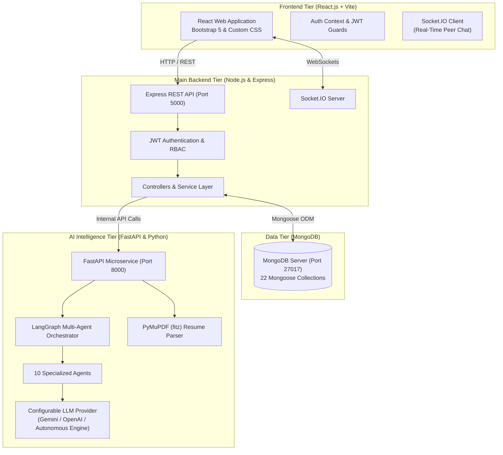

# MentorMind AI

**Full Project Title:** AI-Powered Adaptive Career & Learning Intelligence Platform  
**Tagline:** *Your Skills. Your Goals. Your AI Mentor.*  
**Product Category:** AI-powered education technology, career intelligence, personalized learning, and collaborative development platform.

---

## 🚀 Overview

**MentorMind AI** is a production-quality, full-stack SaaS platform designed to transform how learners discover, track, and achieve their career goals. Unlike traditional educational platforms that recommend identical courses to every user, MentorMind AI understands each learner's existing skills, career aspirations, and assessment performance.

The platform orchestrates **10 specialized AI agents** that collaborate to analyze learner profiles, extract verified competencies from resume PDFs using PyMuPDF, calculate exact skill gaps, generate prerequisite-ordered adaptive roadmaps, simulate live mock interviews, and match learners with complementary peer study partners.

---

## 🌟 Key Differentiating Features

### 1. 🤝 AI Peer Skill Matching
Connects learners with similar career goals and **complementary skills** using a transparent 5-factor weighted algorithm:
$$\text{Compatibility} = 0.30 \cdot C_{\text{career}} + 0.35 \cdot S_{\text{comp}} + 0.15 \cdot I_{\text{interests}} + 0.10 \cdot A_{\text{avail}} + 0.10 \cdot L_{\text{style}}$$
- Example: Pairs a learner strong in React but missing Node.js with a peer strong in Node.js looking to learn React.
- Enables collaborative study groups, weekly sprint challenges, and real-time private messaging powered by **Socket.IO**.

### 2. 🎙️ AI Mock Interview Room
An interactive simulation environment providing career-specific technical, behavioral, HR, and scenario-based interviews.
- Dual text and Web Speech API voice support (speech-to-text dictation & speech synthesis question read-out).
- Objective rubric evaluation across **Technical Depth**, **Relevance**, **Completeness**, and **Clarity**.
- Generates comprehensive diagnostic reports detailing strong points, weak points, and missed concepts.
- Automatically adjusts the learner's roadmap based on interview performance.

### 3. 🧠 Multi-Agent LangGraph Intelligence
Ten specialized collaborative AI agents running on a unified coordination graph:
1. **Profile Analysis Agent** — Ingests profile & PyMuPDF extracted resume credentials.
2. **Career Intelligence Agent** — Analyzes role requirements across 12 industry career paths.
3. **Skill Gap Analysis Agent** — Computes exact gap percentages: `Gap = Required Score - Current Score`.
4. **Learning Path Agent** — Generates structured 4-phase roadmaps with prerequisite dependencies.
5. **Resource Recommendation Agent** — Curates verified materials from MDN, freeCodeCamp, official docs, and YouTube.
6. **Assessment Agent** — Generates skill evaluations and evaluates technical and scenario questions.
7. **Progress Evaluation Agent** — Monitors performance curves and triggers adaptive roadmap adjustments.
8. **AI Mentor Agent** — Context-aware conversational co-pilot answering domain questions.
9. **Peer Matching Agent** — Discovers reciprocal study partners with complementary competencies.
10. **Mock Interview Agent** — Conducts and evaluates simulated interviews with actionable feedback.

---

## 🏗️ System Architecture



---

## 💻 Technology Stack

- **Frontend:** React 18, Vite, Bootstrap 5, Bootstrap Icons, Custom CSS, React Router DOM, Axios, Recharts, Socket.IO Client, Canvas-Confetti.
- **Main Backend:** Node.js, Express.js, MongoDB, Mongoose ODM, JWT, bcryptjs, Multer, Socket.IO, Helmet, Express-Rate-Limit.
- **AI Backend:** Python 3.12, FastAPI, Uvicorn, Pydantic, PyMuPDF (fitz), Scikit-Learn, NumPy, Httpx, LangGraph multi-agent orchestration.
- **Database:** MongoDB (22 production collections).

---

## ⚡ Quick Start

### 1. Start MongoDB Daemon
```bash
mongod --dbpath "data/db" --bind_ip 127.0.0.1 --port 27017
```

### 2. Start Python AI Multi-Agent Service
```bash
# In ai-service directory
& "ai-service/venv/Scripts/uvicorn.exe" app.main:app --app-dir "ai-service" --host 127.0.0.1 --port 8000
```
*Health Check: `http://localhost:8000/health`*

### 3. Start Node.js Backend Server
```bash
cd backend
npm run seed     # Seeds 12 careers, 30+ skills, assessments, and demo accounts
npm start        # Starts server on port 5000
```
*Health Check: `http://localhost:5000/api/health`*

### 4. Start React Frontend
```bash
cd frontend
npm run dev      # Starts Vite development server on port 5173
```
*Access UI at: `http://localhost:5173/`*

---

## 🔑 Pre-Configured Demo Credentials

For immediate exploration and presentation without manual registration:

| Role | Email | Password | Details |
|------|-------|----------|---------|
| **Learner** | `demo@mentormind.ai` | `Password123!` | Jordan Rivera, Full Stack Developer Path, 48% Readiness, active roadmap, 5-day streak |
| **Admin** | `admin@mentormind.ai` | `AdminPassword123!` | Administrator dashboard, system health telemetry, learner management, AI logs |
| **Peer** | `maya.backend@mentormind.ai` | `Password123!` | Maya Chen (94% Compatibility Match, excels in Node/MongoDB, wants to learn React) |

---

## 📁 Repository Structure


```
MentorMind-AI/
├── frontend/                     # React.js + Vite Application
│   ├── src/
│   │   ├── components/           # Reusable UI components
│   │   ├── context/              # AuthContext & global state
│   │   ├── layouts/              # DashboardLayout & Navigation
│   │   ├── pages/                # 20+ complete application views
│   │   ├── services/             # Axios API client & endpoints
│   │   └── styles/               # Design system & custom CSS
│   ├── index.html
│   └── vite.config.js
├── backend/                      # Node.js + Express Main Backend
│   ├── src/
│   │   ├── config/               # MongoDB Mongoose connection
│   │   ├── controllers/          # Business logic controllers
│   │   ├── middleware/           # Auth, rate-limiter, error handling
│   │   ├── models/               # 22 Mongoose Database Schemas
│   │   ├── routes/               # Modular Express API route groups
│   │   ├── sockets/              # Socket.IO real-time chat
│   │   └── utils/                # Database seedData generator
│   └── server.js
├── ai-service/                   # FastAPI Python Multi-Agent Service
│   ├── app/
│   │   ├── agents/               # 10 Specialized AI Agents
│   │   ├── graphs/               # Orchestration workflow
│   │   ├── schemas/              # Pydantic data models
│   │   ├── services/             # LLM provider & PyMuPDF parser
│   │   └── main.py               # FastAPI entrypoint
│   └── requirements.txt
├── docs/                         # Architecture, API & DB Documentation
│   ├── architecture.md
│   ├── api-documentation.md
│   ├── database-design.md
│   └── setup-guide.md
└── README.md
```

---

## 🛡️ Security & Privacy

- **Safe Credential Storage:** Passwords hashed with bcrypt (salt rounds = 10).
- **JWT Protection:** Short-lived tokens with bearer token verification.
- **Role-Based Access Control (RBAC):** Distinct authorization tiers for learners and administrators.
- **File Validation:** Multer restricts uploads strictly to validated PDF documents with size constraints.
- **Network Boundaries:** Autonomous fallback mode guarantees zero external data leakage when operated offline.

---

## 📄 License

Developed for hackathon & educational technology demonstration. Built with standard open-source web and AI engineering frameworks.
