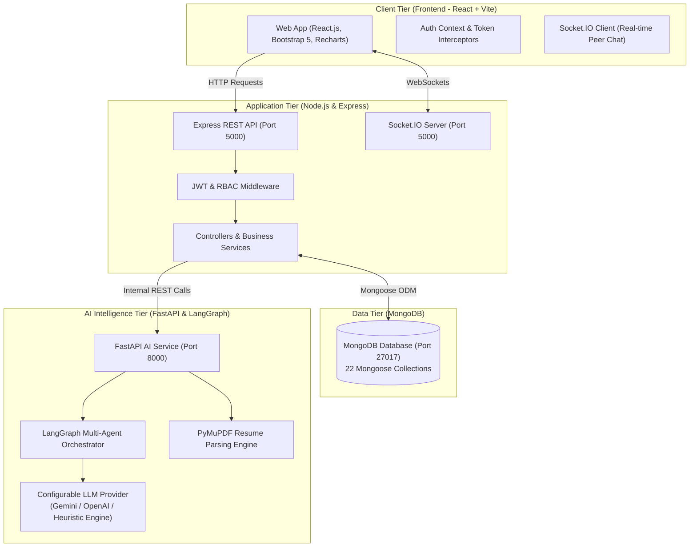
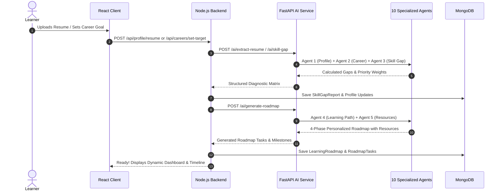

# MentorMind AI — System Architecture

**MentorMind AI** is an intelligent full-stack career development and learning acceleration platform that combines deterministic evaluation metrics with a multi-agent orchestration architecture.

---

## 1. High-Level System Architecture Diagram

---

## 2. Multi-Agent Orchestration Graph

The platform coordinates 10 specialized AI agents working together in a unified state graph:

---

## 3. The 10 Specialized Agents

| # | Agent Name | Primary Responsibility |
|---|------------|------------------------|
| **1** | **Profile Analysis Agent** | Ingests parsed resume data and learner profile to extract validated skill proficiencies. |
| **2** | **Career Intelligence Agent** | Analyzes industry job requirements and explains role suitability without generic claims. |
| **3** | **Skill Gap Analysis Agent** | Calculates exact differences: `Skill Gap = Required Proficiency - Current Proficiency`. |
| **4** | **Learning Path Agent** | Organizes topics into prerequisite-ordered phases and assigns estimated study times. |
| **5** | **Resource Recommendation Agent** | Matches curated documentation, tutorials, and hands-on platforms to skill gaps. |
| **6** | **Assessment Agent** | Generates skill questions and provides rubric-driven feedback on short answers. |
| **7** | **Progress Evaluation Agent** | Tracks assessment scores and triggers adaptive roadmap adjustments. |
| **8** | **AI Mentor Agent** | Context-aware conversational co-pilot answering domain questions and explaining concepts. |
| **9** | **Peer Matching Agent** | Calculates weighted compatibility based on mutual goals and complementary skills. |
| **10** | **Mock Interview Agent** | Simulates technical, behavioral, and HR interviews with objective rubric scoring. |

---

## 4. Differentiating Algorithms

### A. AI Peer Skill Matching Formula

Compatibility is scored from 0% to 100% across five weighted factors:

$$\text{Compatibility} = 0.30 \cdot C_{\text{career}} + 0.35 \cdot S_{\text{comp}} + 0.15 \cdot I_{\text{interests}} + 0.10 \cdot A_{\text{avail}} + 0.10 \cdot L_{\text{style}}$$

- **Career Similarity ($C_{\text{career}}$):** 30% — Same target role yields maximum score.
- **Complementary Skills ($S_{\text{comp}}$):** 35% — Evaluates whether Learner A can teach what Learner B wants to learn, and vice versa.
- **Learning Interests ($I_{\text{interests}}$):** 15% — Shared topic domains and project types.
- **Availability Compatibility ($A_{\text{avail}}$):** 10% — Closeness in weekly study hours.
- **Learning Style Compatibility ($L_{\text{style}}$):** 10% — Alignment in preferred collaboration format.

### B. Adaptive Learning Engine Thresholds

The system continuously evaluates assessment performance:

- **Score $< 50\%$ (Remediation Mode):**
  Identifies weak topics, queues prerequisite refresher modules, and reduces topic difficulty.
- **Score $50\% - 75\%$ (Consolidation Mode):**
  Recommends targeted practice exercises and reinforces fundamental syntax.
- **Score $> 75\%$ (Acceleration Mode):**
  Unlocks advanced topics, accelerates pacing, and suggests real-world capstone projects.
